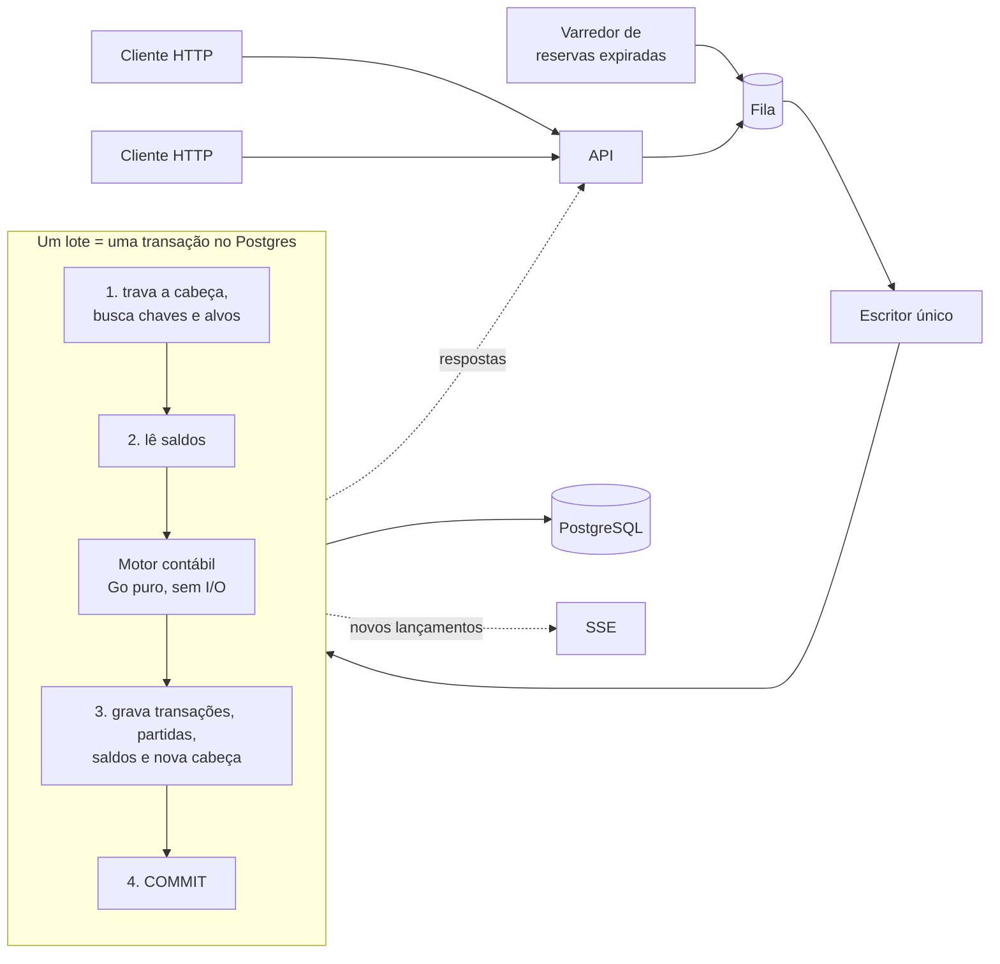

# razão

**Livro-razão de partidas dobradas, com escritor único, commit em grupo e cadeia de hashes.**

O razão é o núcleo contábil que uma fintech coloca atrás de carteiras, pagamentos e conciliação:
contas, lançamentos que sempre fecham, reservas em duas fases, estornos e idempotência. Ele roda
sobre PostgreSQL e foi desenhado em torno de uma ideia: **todas as escritas passam por um único
escritor que grava em lotes**. Isso dá ordem total ao diário, elimina deadlocks e faz a vazão
crescer com a pressão em vez de desabar.

```
> razao bench -seconds 10 -workers 1024 -compare

carga: 1024 clientes, 2000 carteiras, 20% em contas quentes, 10s por medição

sem agrupar (lote=1)         156 tx/s   p50 5077.66 ms   p99 6910.44 ms   lote médio     1.0
commit em grupo (≤2000)    11386 tx/s   p50   92.36 ms   p99  185.56 ms   lote médio   590.0

cadeia de hashes: OK   117997 transações em 1106 ms
contabilidade:    OK   307499 partidas, balancete fecha, saldos batem com o diário (1077 ms)
```

O mesmo código, o mesmo banco, a mesma durabilidade (fsync ligado): **73 vezes mais vazão** só por
agrupar commits.

## Sumário

- [O que ele faz](#o-que-ele-faz)
- [Como rodar](#como-rodar)
- [A interface](#a-interface)
- [Arquitetura](#arquitetura)
- [Desempenho](#desempenho)
- [Auditoria](#auditoria)
- [API](#api)
- [Linha de comando](#linha-de-comando)
- [Testes](#testes)
- [Estrutura do projeto](#estrutura-do-projeto)
- [Decisões e limites](#decisões-e-limites)

## O que ele faz

| Capacidade | Como funciona |
|---|---|
| **Partidas dobradas** | Um lançamento tem de 2 a 64 partidas. Por moeda, débitos = créditos, ou ele é recusado |
| **Tipos de conta** | Ativo e despesa crescem a débito; passivo, patrimônio e receita crescem a crédito |
| **Proteção contra saldo negativo** | Contas marcadas (carteiras de clientes, por padrão) nunca ficam com disponível abaixo de zero |
| **Reservas em duas fases** | `pending` separa o valor sem movimentá-lo; depois `post` captura ou `void` libera. Reservas com prazo expiram sozinhas |
| **Estornos** | Um lançamento pode ser estornado uma vez; o estorno é um novo lançamento com as partidas invertidas |
| **Idempotência** | Toda escrita exige `Idempotency-Key`. Repetir devolve a mesma transação; reutilizar a chave com outro conteúdo dá `409` |
| **Diário imutável** | `transactions` e `entries` só aceitam `INSERT` (gatilho no banco) e cada linha carrega o hash da anterior |
| **Auditoria** | Verificação da cadeia de hashes e reconstrução de todos os saldos a partir das partidas |
| **Feed ordenado** | `GET /v1/events?after=seq` entrega o diário em ordem total para integrações |

Valores são inteiros em unidades mínimas (centavos). Não há ponto flutuante em lugar nenhum do
caminho do dinheiro.

## Como rodar

Pré-requisitos: **Docker Desktop**, **Go 1.26+** e **Node 22+**.

```powershell
.\run.ps1
```

ou dois cliques em `run.bat`. O script inicia o Docker Desktop se ele estiver parado, sobe o
Postgres, compila a interface, embute-a no binário e abre `http://127.0.0.1:7878` em modo de
demonstração.

| Comando | O que faz |
|---|---|
| `.\run.ps1` | Sobe tudo e abre a interface |
| `.\run.ps1 -Dev` | Backend + Vite com hot reload em `http://localhost:5174` |
| `.\run.ps1 -Test` | `go vet`, testes de unidade e de integração (Postgres real) e tipos do frontend |
| `.\run.ps1 -Bench` | Benchmark: sem agrupar × commit em grupo, seguido de auditoria completa |
| `.\run.ps1 -Down` | Para o Postgres (os dados ficam no volume Docker) |
| `.\run.ps1 -NoDemo` | Sem seed, teste de carga e adulteração pela interface |

O Postgres fica na porta **54329** para não brigar com uma instalação local. Para usar outro banco,
defina `RAZAO_DATABASE_URL`. Para exigir chave nas escritas, defina `RAZAO_API_KEY`.

### Roteiro de 3 minutos

1. No painel vazio, clique em **Criar dados de exemplo**: um banco, 200 carteiras e uma conta de
   receita, cada carteira com R$ 1.000,00.
2. Em **Teste de carga**, clique em **Iniciar carga** e veja a vazão subir e os lançamentos
   chegarem ao vivo.
3. Em **Diário → Novo lançamento**, mova dinheiro entre duas carteiras marcando *Criar como
   reserva*. Abra a reserva e clique em **Capturar**.
4. Abra uma das carteiras em **Contas**: o razonete e o extrato com saldo corrido.
5. Em **Auditoria**, clique em **Verificar** e **Conferir**. Depois em **Adulterar uma partida**: a
   cadeia aponta a transação exata, e a contabilidade mostra a conta cujo saldo deixou de bater.

## A interface

React 19 + TypeScript, servida pelo próprio binário.

- **Painel**: transações, vazão, latência p50/p99, tamanho médio de lote, gráfico de vazão dos
  últimos 60 s, balancete por moeda, feed ao vivo por SSE e o teste de carga.
- **Contas**: plano de contas com busca, saldo e disponível. Cada conta tem razonete (o "T") e
  extrato com saldo após cada partida.
- **Diário**: todas as transações, filtráveis por tipo. Cada uma mostra as partidas em duas colunas,
  o elo da cadeia de hashes e as ações possíveis (capturar, cancelar, estornar).
- **Novo lançamento**: várias partidas, com conferência ao vivo de débitos × créditos. A chave de
  idempotência é gerada no formulário, então um clique duplo não lança duas vezes.
- **Auditoria**: as duas verificações e a demonstração de adulteração.

## Arquitetura



### Escritor único com commit em grupo

Não há temporizador. Enquanto um lote está sendo gravado, os pedidos que chegam se acumulam na
fila e viram o lote seguinte. Com pouca carga, um pedido é o seu próprio lote e paga um commit
inteiro; com muita carga, centenas dividem o mesmo commit. O sistema se ajusta sozinho.

Cada lote custa **quatro idas ao banco**, não importa quantos comandos carregue:

1. `SELECT ... FROM ledger_head FOR UPDATE` junto com a busca de chaves de idempotência e de
   transações-alvo (um único envio em pipeline);
2. leitura dos saldos das contas envolvidas;
3. todas as escritas, como comandos `INSERT ... SELECT FROM unnest(...)` e um `UPDATE ... FROM
   unnest(...)` sobre arrays (um único envio);
4. `COMMIT`.

A trava na linha `ledger_head` é o que serializa os escritores: dois processos do razão sobre o
mesmo banco continuam corretos e produzem uma única ordem total (há um teste para isso). Como só
um lote roda por vez, não é preciso travar as linhas de saldo e não existe deadlock possível.

### Motor contábil puro

`internal/ledger` não faz I/O. `Apply(estado, comandos)` recebe os saldos e as transações
relevantes já carregados e devolve um resultado por comando e as novas transações. Um comando
recusado (saldo insuficiente, lançamento que não fecha) não afeta os outros do lote: o motor
desfaz só os efeitos dele.

Isso permite testar as regras com cargas aleatórias, sem banco, conferindo os invariantes depois de
cada lote.

### Modelo de dados

```
accounts      plano de contas, imutável
balances      um saldo por conta: débitos e créditos contabilizados e pendentes
transactions  o diário: seq (ordem total), tipo, chave de idempotência, prev_hash, hash
entries       as partidas: transação, conta, lado, valor, saldo depois
ledger_head   uma linha: seq e hash da última transação (e a trava dos escritores)
```

Os quatro tipos de transação são todos linhas novas, nunca atualizações:

| Tipo | Efeito no saldo |
|---|---|
| `posted` | soma no contabilizado |
| `pending` | soma no pendente (reserva) |
| `post` | tira do pendente e soma no contabilizado; referencia a reserva |
| `void` | tira do pendente; referencia a reserva |

"Esta reserva já foi resolvida?" é respondido por um índice único parcial em `related_id`, não por
uma coluna de status mutável.

## Desempenho

Medido nesta máquina: 12 threads, Windows 11, PostgreSQL 17 dentro do Docker Desktop (WSL2),
`fsync` e `synchronous_commit` ligados. Cada "transação" da carga é um pagamento com tarifa (3
partidas), um depósito (2 partidas) ou uma reserva seguida de captura/cancelamento.

| Clientes concorrentes | Vazão | p50 | p99 | Lote médio |
|---:|---:|---:|---:|---:|
| 16 | 942 tx/s | 15 ms | 45 ms | 8 |
| 64 | 2.138 tx/s | 27 ms | 80 ms | 32 |
| 256 | 6.877 tx/s | 36 ms | 77 ms | 138 |
| 1.024 | 11.386 tx/s | 92 ms | 186 ms | 590 |
| 2.048 | 13.291 tx/s | 162 ms | 267 ms | 1.195 |
| 1.024, **sem agrupar** | 156 tx/s | 5.078 ms | 6.910 ms | 1 |

Leia com as ressalvas certas:

- **É medido dentro do processo** (o gerador de carga chama o escritor diretamente), então exclui o
  custo de HTTP. Pela API os números serão menores.
- **Docker Desktop no Windows é um ambiente lento para disco.** Em execuções repetidas a vazão com
  256 clientes variou entre ~4 e ~7 mil tx/s, e o Postgres aparece esperando `WalWrite`. Em Linux
  nativo com NVMe a expectativa é bem melhor, mas eu não medi.
- A latência cresce com a concorrência porque o lote cresce: é a troca que o commit em grupo faz.

### Duas otimizações que os números guiaram

O primeiro benchmark deu 3.145 tx/s. Instrumentei as fases do lote antes de mexer em qualquer coisa:

1. **Chaves estrangeiras em `entries`.** Gravar 600 partidas levava 45 ms de um lote de 55 ms. Sem
   as duas FKs, 4 ms. A verificação por linha (gatilhos de integridade referencial) custava ~85% do
   lote. Elas saíram do esquema; a referência é garantida pelo escritor (que só grava partidas de
   transações do mesmo lote e de contas que validou) e o verificador de integridade procura
   partidas órfãs. Vazão: 3.145 → 6.267 tx/s.
2. **Idas ao banco.** O lote fazia ~12. Agrupando leituras e escritas em pipeline ficaram 4.
   Vazão com 256 clientes: 6.267 → ~7.000 tx/s; com 2.048 clientes, 13 mil.

E uma correção: a conferência contábil levava **31 s** logo depois de uma carga em banco novo,
porque as estatísticas do planejador estavam vazias e ele escolhia *nested loops*. Forçar *hash
join* nessa transação (`SET LOCAL enable_nestloop = off`) a levou a **1 s**, sem depender do
autoanalyze.

## Auditoria

### Cadeia de hashes

```
hash(n) = SHA-256( hash(n-1) ‖ seq ‖ id ‖ tipo ‖ relacionada ‖ chave ‖ histórico ‖ metadados
                   ‖ expiração ‖ data ‖ partidas(conta, lado, valor)... )
```

Os campos são codificados com prefixo de tamanho, então duas transações diferentes nunca têm a
mesma codificação. `razao verify` (ou o botão na interface) refaz a cadeia inteira num único
snapshot e para na primeira linha que não bate: valor alterado, conta trocada, transação apagada ou
fora de ordem.

O que a cadeia **garante**: quem altera o banco por fora é detectado, e sabe-se exatamente a partir
de onde. O que ela **não garante**: alguém com acesso total que recalcule todos os hashes dali até
a cabeça passa despercebido. Para fechar essa porta, a cabeça precisa ser ancorada fora do banco
(publicada, assinada ou enviada a um cofre de objetos imutável) em intervalos regulares. Não está
implementado; a cabeça é exposta em `/v1/stats` justamente para isso.

### Conferência contábil

`POST /v1/audit/integrity` verifica, num único snapshot:

- o balancete: soma de débitos = soma de créditos, por moeda, contabilizado e pendente;
- **cada saldo materializado contra o diário**, reconstruindo-o a partir de todas as partidas;
- transações em que débitos ≠ créditos;
- partidas órfãs (sem transação ou sem conta).

## API

Erros têm sempre a forma `{"error": {"code": "...", "message": "..."}}`.

| Método | Rota | Descrição |
|---|---|---|
| `POST` | `/v1/accounts` | Cria conta: `{code, name, type, currency, allowNegative?}` |
| `GET` | `/v1/accounts?search=&after=&limit=` | Lista, paginada por código |
| `GET` | `/v1/accounts/{id ou código}` | Conta com saldo, contabilizado e disponível |
| `GET` | `/v1/accounts/{ref}/statement?before=` | Extrato com saldo após cada partida |
| `POST` | `/v1/transactions` | Lançamento ou reserva. Exige `Idempotency-Key` |
| `GET` | `/v1/transactions?before=&kind=` | Diário, do mais novo para o mais antigo |
| `GET` | `/v1/transactions/{id}` | Uma transação, com partidas e elos da cadeia |
| `POST` | `/v1/transactions/{id}/post` | Captura uma reserva |
| `POST` | `/v1/transactions/{id}/void` | Cancela uma reserva |
| `POST` | `/v1/transactions/{id}/reverse` | Estorna um lançamento |
| `GET` | `/v1/events?after=seq&limit=` | Feed em ordem total para integrações |
| `GET` | `/v1/stats` | Métricas do escritor e balancete |
| `GET` | `/v1/stream` | SSE: métricas e novos lançamentos |
| `POST` | `/v1/audit/chain` | Verifica a cadeia de hashes |
| `POST` | `/v1/audit/integrity` | Conferência contábil |
| `GET` | `/healthz` | Saúde (inclui o banco) |

Um pagamento de R$ 50,00 com tarifa de R$ 0,50:

```bash
curl -X POST http://127.0.0.1:7878/v1/transactions \
  -H 'Idempotency-Key: pedido-1042' -H 'Content-Type: application/json' \
  -d '{
    "description": "pagamento do pedido 1042",
    "postings": [
      {"account": "passivo:carteira:00001", "direction": "debit",  "amount": 5050},
      {"account": "passivo:carteira:00002", "direction": "credit", "amount": 5000},
      {"account": "receita:tarifas",        "direction": "credit", "amount": 50}
    ]
  }'
```

Resposta `201`; repetir a mesma requisição devolve `200` com o cabeçalho `Idempotent-Replayed: true`
e a mesma transação.

| Código de erro | HTTP | Quando |
|---|---|---|
| `invalid_request` | 400 | JSON inválido, campo fora do intervalo, sem `Idempotency-Key` |
| `unbalanced` | 422 | Débitos e créditos não fecham em alguma moeda |
| `insufficient_funds` | 422 | A conta não pode ficar negativa e não tem disponível |
| `account_not_found`, `not_found` | 404 | |
| `idempotency_conflict` | 409 | Chave já usada com outro conteúdo |
| `already_resolved`, `already_reversed`, `not_pending`, `not_reversible`, `pending_expired` | 409 | |
| `unavailable` | 503 | O banco falhou; nada foi gravado, repita com a mesma chave |

## Linha de comando

```
razao serve   [-addr 127.0.0.1:7878] [-batch 2000] [-demo]
razao bench   [-seconds 10] [-workers 256] [-wallets 2000] [-batch 2000] [-hot 0.2] [-compare]
razao verify             re-calcula a cadeia de hashes e confere os saldos (sai com 3 se falhar)
razao reset   -yes       apaga todos os dados
```

## Testes

```powershell
.\run.ps1 -Test
```

| Pacote | O que cobre |
|---|---|
| `internal/ledger` | Partidas dobradas, moedas separadas, regra de saldo, idempotência (inclusive por ID × por código e dentro do mesmo lote), duas fases, expiração, estorno, estouro de 64 bits, cadeia de hashes. **Teste de propriedade**: 30 sementes × 60 lotes de comandos aleatórios, válidos e inválidos, conferindo após cada lote que os saldos batem com o diário refeito do zero, que todo lançamento fecha, que nenhuma conta protegida ficou negativa e que o balancete fecha |
| `internal/store` | Contra Postgres real: ida e volta do diário, replay lido do banco com o mesmo hash, duas fases e estorno entre lotes, **gatilho de imutabilidade**, **adulteração detectada na transação exata**, e **dois escritores concorrentes** com 48 clientes em 12 carteiras disputadas (5 mil transações, repetições pelo outro escritor, conservação do dinheiro) |
| `internal/api` | Ciclo completo por HTTP, extrato com saldo corrido, todos os códigos de erro, chave de API, rejeição de escrita entre origens, stream SSE durante um teste de carga, adulteração e restauração |

Cada pacote de integração usa um banco próprio (`razao_test_<pacote>`), criado sob demanda, então
os pacotes rodam em paralelo. Sem Postgres disponível, esses testes são pulados.

## Estrutura do projeto

```
cmd/razao/               serve, bench, verify, reset
internal/
  ledger/                tipos, motor contábil puro, cadeia de hashes
  store/                 PostgreSQL: migrações, lote, leituras, auditoria
    migrations/          esquema SQL embutido no binário
  pipeline/              escritor único, commit em grupo, métricas
  api/                   HTTP, SSE, rotas de demonstração
  loadgen/               gerador de carga
  demo/                  plano de contas de exemplo
  testdb/                banco isolado por pacote de teste
web/                     React 19 + TypeScript + Vite + Tailwind v4 + TanStack Query
docker-compose.yml       PostgreSQL 17
run.ps1 / run.bat        sobe tudo
```

**Backend:** Go 1.26, `pgx/v5` e `google/uuid` (UUIDv7, ordenáveis no tempo). Roteamento e servidor
HTTP da biblioteca padrão.
**Frontend:** React 19, TypeScript 7, Vite 8, Tailwind CSS 4, TanStack Query 5, React Router 8.

## Decisões e limites

- **Um escritor por vez, por desenho.** A vazão de escrita é limitada pelo que um lote consegue
  gravar. Não escala horizontalmente adicionando processos (eles se revezam na trava). Em troca:
  ordem total, zero deadlock, código simples. É a mesma aposta do TigerBeetle e do LMAX.
- **Comandos recusados não são gravados.** Uma repetição com a mesma chave é reavaliada, e pode
  passar se a situação mudou (o saldo chegou, por exemplo).
- **Sem câmbio.** Um lançamento com várias moedas precisa fechar em cada uma separadamente;
  conversão se modela com contas de posição cambial.
- **Captura é sempre total.** Não há captura parcial de uma reserva.
- **Contas são imutáveis.** Não dá para renomear nem fechar uma conta.
- **Autenticação mínima.** Uma chave única para escritas, sem usuários nem permissões. As leituras
  são abertas: rode atrás de uma rede confiável.
- **A cabeça da cadeia não é ancorada externamente** (veja [Auditoria](#auditoria)).
- **Sem particionamento.** `transactions` e `entries` crescem para sempre; num uso real, particionar
  por faixa de `seq` e arquivar.

## Licença

MIT. Veja [LICENSE](LICENSE).
